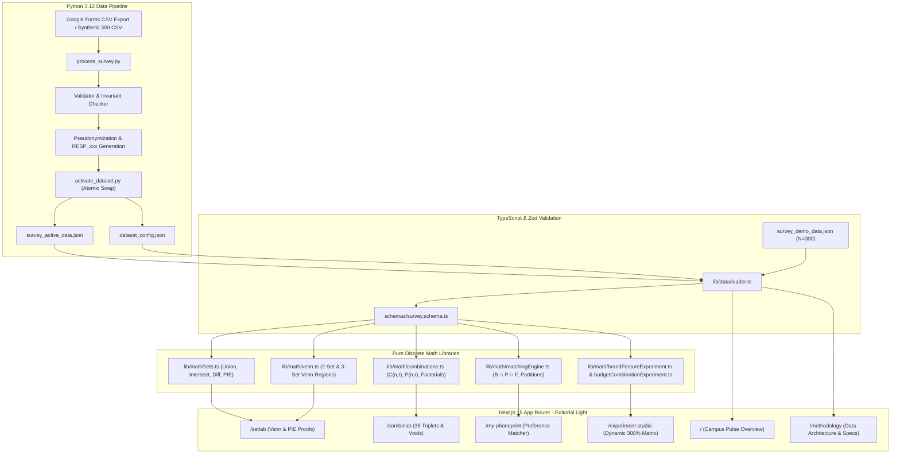
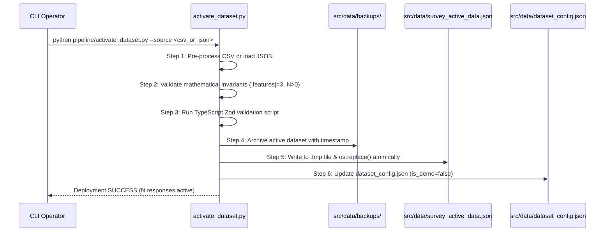

# PhonePrint: Final Technical Architecture & Engineering Documentation
## System Specifications, Mathematical Libraries, Data Pipelines & Quality Audits
**Document Version**: 3.0.0 (Light Editorial Redesign & N=300 Simulated Dataset)  
**Target Environment**: Production / Presentation  
**Runtime**: Node.js 18+ / 24+ | Python 3.10+ / 3.12+  
**Framework**: Next.js 15.2 (App Router, React 19, TypeScript 5.8)  
**Design Theme**: Editorial Light Theme (`#FBFBF9` warm paper, `#181715` typography, cobalt/lime accents)  
**Active Dataset**: Simulated Campus Survey Benchmark (`is_demo = true`, $N=300$)  

---

## 1. System Architecture & Component Hierarchy

### 1.1 Architectural Philosophy
PhonePrint is engineered as a zero-dependency, statically pre-rendered client application backed by an offline, mathematically verified data processing pipeline. All mathematical calculations, set algebra, and combinatorial enumerations execute client-side in pure TypeScript, ensuring instantaneous user feedback, offline resiliency, and academic transparency.



### 1.2 Module Directory Hierarchy
```text
PhonePrint/
├── pipeline/                           # Offline Python Data Hygiene & Ingestion Pipeline
│   ├── process_survey.py               # Raw survey sanitization, validation & anonymization
│   ├── activate_dataset.py             # Atomic dataset deployment and rollback manager
│   ├── column_mapping.json             # Synonym mapping for Google Forms questions
│   ├── test_pipeline.py                # Pipeline regression tests (25 passing tests)
│   └── test_raw_survey_export.csv      # Test survey fixture
├── src/
│   ├── app/                            # Next.js App Router Page Entrypoints
│   │   ├── page.tsx                    # Campus Pulse Dashboard
│   │   ├── my-phoneprint/page.tsx      # Preference Matcher Engine
│   │   ├── setlab/page.tsx             # Interactive Discrete SetLab
│   │   ├── combolab/page.tsx           # Combinatorial Feature Space
│   │   ├── experiment-studio/page.tsx  # Hypothesis Testing Studio
│   │   ├── methodology/page.tsx        # Formal Technical & Math Methodology
│   │   ├── layout.tsx                  # Root HTML shell & metadata
│   │   └── globals.css                 # Tailwind directives & design tokens
│   ├── components/                     # Reusable UI & Mathematical Components
│   │   ├── layout/                     # Navbar, Footer, Route Shells
│   │   ├── campus-pulse/               # Demographic & Feature Distribution Cards
│   │   ├── setlab/                     # Venn Diagrams, Set Selectors, PIE Terminal
│   │   ├── combolab/                   # Binomial Calculator, Triplet Grid, Voids
│   │   ├── my-phoneprint/              # Profile Vector Controls, Match Cards
│   │   ├── experiment-studio/          # Brand-Feature Matrix, Budget Distributions
│   │   ├── ui/                         # Badges, Buttons, Cards, StatusDots
│   │   └── visualizations/             # SVG Venn renders, Bar Charts, Tables
│   ├── data/                           # Verified Application Datasets
│   │   ├── dataset_config.json         # Active dataset pointer (demo vs real)
│   │   ├── survey_demo_data.json       # N=300 Simulated student benchmark dataset
│   │   ├── survey_active_data.json     # Active production survey dataset
│   │   └── backups/                    # Timestamped rollback snapshots
│   ├── lib/
│   │   ├── data/                       # Data loading and preprocessing utilities
│   │   │   ├── loader.ts               # Dataset loader with Zod validation
│   │   │   └── combinationAnalytics.ts # Triplet grouping and rank calculations
│   │   └── math/                       # Axiomatic Discrete Mathematical Engines
│   │       ├── sets.ts                 # Set algebra, complements, 2-Set PIE
│   │       ├── venn.ts                 # 2-Set & 3-Set Venn minterms & 3-Set PIE
│   │       ├── combinations.ts         # Factorials, nCr, nPr, permutations
│   │       ├── matchingEngine.ts       # 4-way partitions, overlap metrics
│   │       ├── brandFeatureExperiment.ts # Brand-Feature matrix & 300% sum
│   │       └── budgetCombinationExperiment.ts # Budget-triplet cross tabulations
│   ├── schemas/
│   │   └── survey.schema.ts            # Zod validation schemas and invariants
│   ├── types/                          # TypeScript Domain Models & Interfaces
│   │   ├── survey.ts                   # Core survey entities and unions
│   │   ├── matcher.ts                  # Preference matching structures
│   │   └── experiment.ts               # Cross-tabulation matrices & rows
│   └── __tests__/                      # Automated Vitest Test Suite (135 tests)
│       ├── fixtures/                   # Synthetic stress test generator (N=300, 1000)
│       ├── sets.test.ts                # Set operations unit tests
│       ├── venn.test.ts                # Venn minterm and 3-set PIE tests
│       ├── combinations.test.ts        # Factorial and combinations tests
│       ├── matching_engine.test.ts     # Matcher partition conservation tests
│       ├── brand_feature_experiment.test.ts # Dynamic 300% sum tests
│       ├── budget_combination_experiment.test.ts # Budget tier tests
│       └── stress_test.test.ts         # High-volume scalability benchmarks
```

---

## 2. Data Schemas & Structural Invariants

### 2.1 Canonical Data Domains
```typescript
export const SMARTPHONE_BRANDS = [
  "Apple",
  "Samsung",
  "Google",
  "OnePlus",
  "Xiaomi",
  "Motorola",
  "Other",
] as const;

export const BUDGET_RANGES = [
  "Under $400",
  "$400 - $700",
  "$700 - $1,000",
  "Over $1,000",
] as const;

export const SMARTPHONE_FEATURES = [
  "Camera Quality",
  "Battery Life",
  "Processing Performance",
  "Display Quality",
  "Storage Capacity",
  "Build & Design Quality",
  "Software & OS Experience",
] as const;
```

### 2.2 Zod Runtime Validation Schemas
```typescript
import { z } from "zod";

export const surveyResponseSchema = z.object({
  response_id: z.string().regex(/^RESP_\d{3,}$/, {
    message: "response_id must follow the format 'RESP_xxx'",
  }),
  preferred_brand: z.enum(SMARTPHONE_BRANDS),
  budget_range: z.enum(BUDGET_RANGES),
  preferred_features: z
    .array(z.enum(SMARTPHONE_FEATURES))
    .length(3, { message: "preferred_features must contain exactly three elements" })
    .refine((features) => new Set(features).size === 3, {
      message: "preferred_features must contain exactly three distinct features",
    }),
});

export const surveyDatasetSchema = z.object({
  dataset_version: z.string(),
  generated_at: z.string().datetime(),
  sample_size: z.number().int().positive(),
  canonical_features: z.array(z.enum(SMARTPHONE_FEATURES)).length(7),
  responses: z.array(surveyResponseSchema),
}).refine((data) => data.responses.length === data.sample_size, {
  message: "sample_size must match responses array length",
}).refine((data) => {
  const ids = new Set(data.responses.map((r) => r.response_id));
  return ids.size === data.responses.length;
}, {
  message: "All response_id values must be unique",
});
```

---

## 3. Mathematical Library Specifications

All mathematical libraries reside in `src/lib/math/` and are fully decoupled from UI rendering.

### 3.1 `sets.ts` — Discrete Set Algebra
* **`setUnion<T>(a, b): Set<T>`**: $A \cup B$. Time Complexity: $O(|A| + |B|)$.
* **`setIntersection<T>(a, b): Set<T>`**: $A \cap B$. Iterates over smaller set: $O(\min(|A|, |B|))$.
* **`setDifference<T>(a, b): Set<T>`**: $A \setminus B$. Iterates over $A$: $O(|A|)$.
* **`symmetricDifference<T>(a, b): Set<T>`**: $A \Delta B = (A \setminus B) \cup (B \setminus A)$. Time: $O(|A| + |B|)$.
* **`setComplement<T>(universe, a): Set<T>`**: $U \setminus A$. Time: $O(|U|)$.
* **`verifyInclusionExclusionPrinciple<T>(a, b)`**:
  Computes:
  $$\text{calculatedRhs} = |A| + |B| - |A \cap B|$$
  Returns `{ unionCardinality, calculatedRhs, isValid: unionCardinality === calculatedRhs }`.

### 3.2 `venn.ts` — Multi-Set Venn Minterms & 3-Set PIE
* **`computeTwoSetVennRegions(universe, setA, setB)`**:
  Partitions $U$ into four mutually disjoint regions:
  1. `onlyA`: $A \setminus B$
  2. `onlyB`: $B \setminus A$
  3. `intersection`: $A \cap B$
  4. `neither`: $U \setminus (A \cup B)$
* **`computeThreeSetVennRegions(universe, setA, setB, setC)`**:
  Partitions $U$ into eight pairwise disjoint regions:
  1. `onlyA`: $A \setminus (B \cup C)$
  2. `onlyB`: $B \setminus (A \cup C)$
  3. `onlyC`: $C \setminus (A \cup B)$
  4. `intersectionABOnly`: $(A \cap B) \setminus C$
  5. `intersectionACOnly`: $(A \cap C) \setminus B$
  6. `intersectionBCOnly`: $(B \cap C) \setminus A$
  7. `intersectionABC`: $A \cap B \cap C$
  8. `outsideAll`: $U \setminus (A \cup B \cup C)$
* **`verifyThreeSetInclusionExclusion(a, b, c)`**:
  Evaluates:
  $$\text{calculatedRhs} = (|A| + |B| + |C|) - (|A \cap B| + |A \cap C| + |B \cap C|) + |A \cap B \cap C|$$
  Verifies that $|A \cup B \cup C| = \text{calculatedRhs}$.

### 3.3 `combinations.ts` — Combinatorial Arithmetic
* **`factorial(n: number): number`**:
  Strict integer calculation for $n \in \{0, 1, \dots, 18\}$.
  Throws `RangeError` if $n < 0$, non-integer, or $n > 18$.
* **`combinations(n, r): number`**:
  Calculates $\binom{n}{r} = \frac{n!}{r!(n - r)!}$ using multiplication cancellation:
  $$\binom{n}{r} = \prod_{i=1}^r \frac{n - r + i}{i}$$
* **`permutations(n, r): number`**:
  Calculates $P(n, r) = \frac{n!}{(n - r)!}$.
* **`enumerateCombinations<T>(elements, k): T[][]`**:
  Generates all $\binom{n}{k}$ subsets using recursive lexicographical backtracking. For $n=7, k=3$, produces exactly 35 triplets.

### 3.4 `matchingEngine.ts` — Preference Matching Engine
* Input: `responses: SurveyResponse[]`, `profile: UserProfileInput`.
* Computes:
  1. $B = \{ u \mid \text{brand}(u) = b^* \}$
  2. $P = \{ u \mid \text{budget}(u) = p^* \}$
  3. $F = \{ u \mid \text{features}(u) = F^* \}$
  4. $\text{ExactMatches} = B \cap P \cap F$
  5. Four-way partition $C_3, C_2, C_1, C_0$ where $\sum_{i=0}^3 |C_i| = N$.
  6. Feature overlap tiers $O_3, O_2, O_1, O_0$ where $\sum_{i=0}^3 |O_i| = N$.

---

## 4. Data Processing Pipeline & Atomic Activation

### 4.1 Data Cleaning & Validation Workflow (`pipeline/process_survey.py`)
1. **Header Normalization**: Strips whitespace, standardizes case, and matches headers against `column_mapping.json`.
2. **Category Synonym Mapping**: Resolves variations (e.g., "Apple iPhone" $\to$ "Apple", "Google Pixel" $\to$ "Google").
3. **Feature Splitting & Strict Invariant Enforcement**: Parses semicolon or comma-delimited feature strings; strictly rejects records where $|F| \ne 3$ or duplicates exist within a record.
4. **Duplicate Submission Detection**:
   - If timestamp exists: Hashes `(timestamp, brand, budget, sorted_features)`. Duplicate submissions are dropped.
   - If timestamp is absent: Retains identical preference answers as legitimate distinct respondents.
5. **Pseudonymization**: Assigns monotonic IDs `RESP_001`, `RESP_002`, $\dots$.
6. **Integrity Validation**: Asserts $N > 0$, ID uniqueness, and valid domain values before saving.

### 4.2 Atomic Deployment Protocol (`pipeline/activate_dataset.py`)


---

## 5. Quality Assurance & Verification Summary

### 5.1 Verification Checklist
* **TypeScript Compiler**: Passed (`tsc --noEmit`), 0 errors.
* **ESLint**: Passed (`next lint`), 0 warnings, 0 errors.
* **Vitest Unit & Stress Suite**: 11 test suites, **135 passed tests**.
* **Python Pipeline Test Suite**: 25 passed unit tests.
* **Next.js Production Build**: 10 static pages pre-rendered successfully.
* **Dataset Safety**: `dataset_config.json` verified with `is_demo=true`, `SIMULATED CAMPUS DATA — N=300`.

### 5.2 Accessibility & Editorial Responsive Design Standards
* **WCAG 2.1 AA Conformance**:
  - Color contrast ratios exceed 4.5:1 for normal text and 3:1 for large text across warm paper tokens (`#FBFBF9`, `#181715`, `#64748B`, `#2563EB`, `#84CC16`).
  - Interactive components feature visible focus rings (`focus-visible:ring-2 focus-visible:ring-cobalt-500`).
  - Screen reader attributes (`aria-label`, `aria-expanded`, `role="region"`) properly configured on all navigation, tab controls, and modals.
* **Responsive Layouts**:
  - Desktop: 1280px+ multi-column editorial grid layouts with fixed-dimension Venn diagrams.
  - Tablet: 768px - 1024px collapsible card grids with generous whitespace.
  - Mobile: 390px - 767px single-column vertical stacking, responsive horizontal table scrolling, touch-target sizing $\ge 44 \times 44$ px.

---
*Technical Documentation certified for Phase 09 Light Editorial & N=300 Release.*
